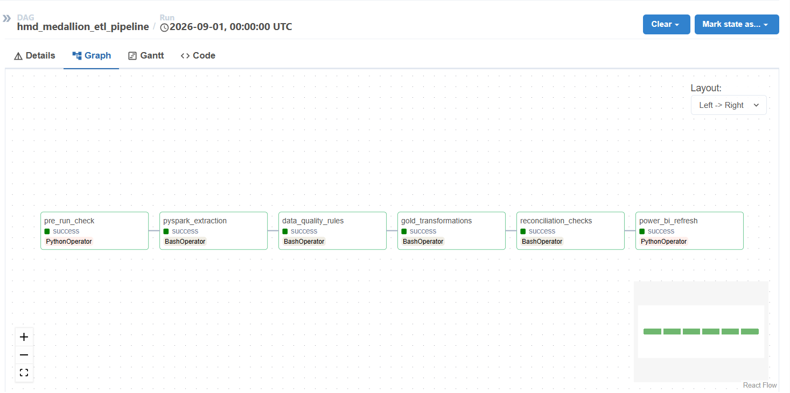
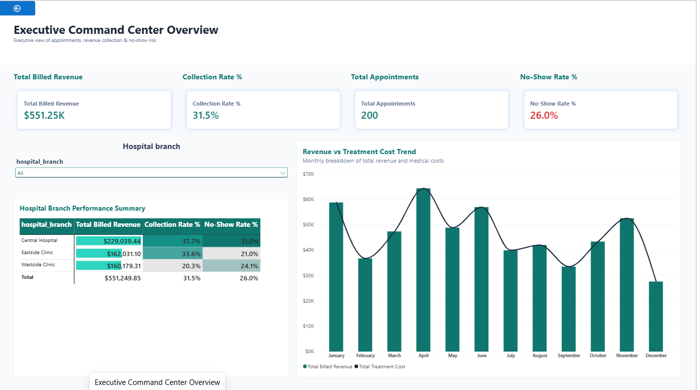
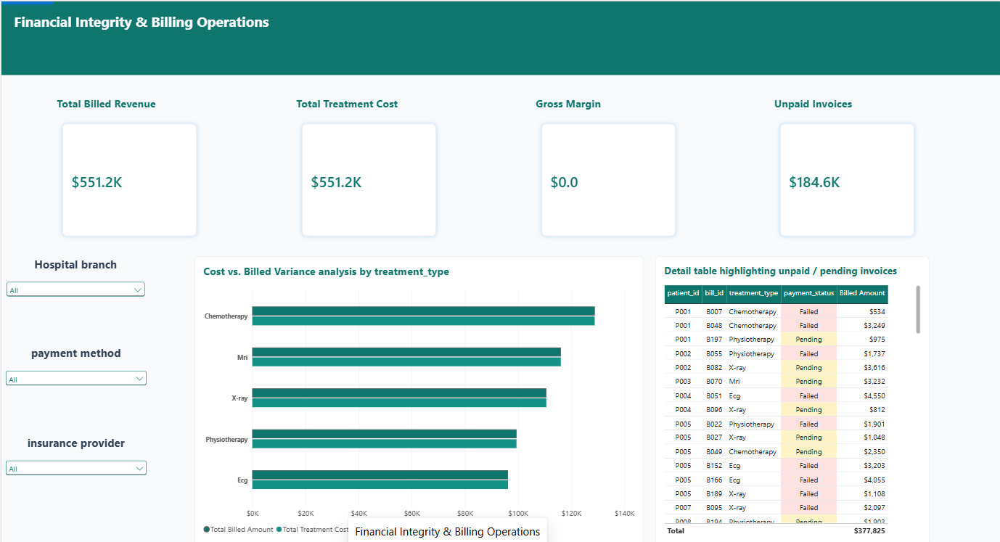
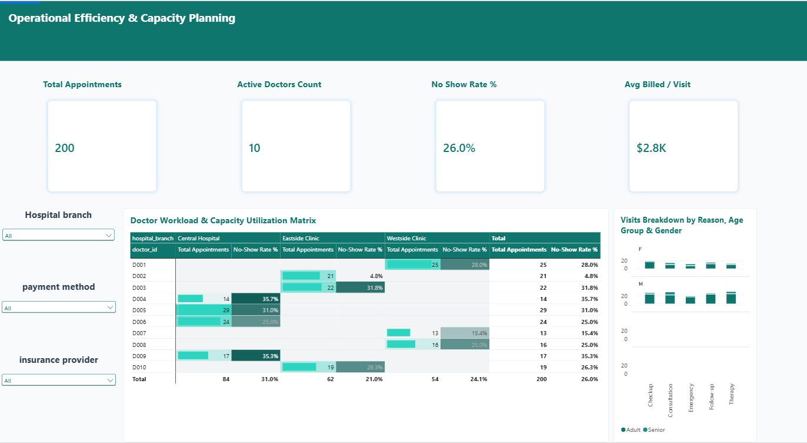

# Healthcare Analytics & Lakehouse Platform

An end-to-end, production-grade **Healthcare Operations & Financial Analytics Platform**, built on a Medallion (Bronze → Silver → Gold) Lakehouse architecture. The pipeline extracts operational data from a live PostgreSQL source, enforces automated data quality gates, models a dimensional star schema, and delivers a 3-page executive Power BI report — all orchestrated end-to-end by Apache Airflow.



📊 [Project presentation](https://github.com/moabdoamer123-cmd/healthcare-analytics-lakehouse/raw/main/Healthcare_Analytics_Lakehouse_Presentation.pptx)

---

## Table of Contents

- [Architecture](#architecture)
- [Tech Stack](#tech-stack)
- [Project Structure](#project-structure)
- [Data Quality & Governance](#data-quality--governance)
- [Gold Layer — Star Schema](#gold-layer--star-schema)
- [Orchestration](#orchestration)
- [Power BI Dashboard](#power-bi-dashboard)
- [Getting Started](#getting-started)
- [Reconciliation & Data Integrity](#reconciliation--data-integrity)
- [Known Assumptions & Limitations](#known-assumptions--limitations)

---

## Architecture

```
Neon PostgreSQL (source)
        │  JDBC extract
        ▼
   BRONZE  (MinIO, s3a://hmd-lakehouse/bronze/)
        │  raw, immutable, append-only, partitioned by ingestion date
        ▼
 DATA QUALITY GATEWAY  ──▶  QUARANTINE  (failed records + reason logs)
        │  cleaned, deduplicated, referentially validated
        ▼
   SILVER  (Parquet + Iceberg — dual-path)
        │  ┌─ Parquet: back-compatibility (dual-path to avoid breaking existing scripts)
        │  └─ Iceberg (s3a://hmd-lakehouse/iceberg/*): ACID transactions, time travel, schema evolution
        ▼
   GOLD    (MinIO  ·  Neon Postgres serving layer)
        │
        ▼
   Power BI  (3-page report — Python connector reads Gold from Neon)
```

Every stage is orchestrated by a single Airflow DAG (`hmd_medallion_etl_pipeline`) running on **CeleryExecutor** with a Redis broker, with real health checks, automated reconciliation, and a Power BI refresh trigger as the final step.

## Tech Stack

| Layer | Technology |
|---|---|
| Source Database | Neon PostgreSQL |
| Object Storage / Lakehouse | MinIO (S3-compatible) |
| Processing Engine | PySpark 3.5.0 (S3A connector) |
| Storage Format | Apache Parquet (Bronze/Silver/Gold) + Apache Iceberg 1.4.0 (Silver) |
| Catalog | Iceberg Hadoop catalog (`glacier_iceberg` — file-based, warehouse on MinIO) |
| Orchestration | Apache Airflow — CeleryExecutor + Redis broker, dedicated Postgres metadata DB |
| Data Quality & Governance | Custom PySpark DQ Gateway |
| BI & Reporting | Power BI (Python connector → Neon Postgres) |
| Containerization | Docker Compose |

## Project Structure

```
healthcare-analytics-lakehouse/
├── dags/
│   └── hmd_medallion_etl_pipeline.py     # Airflow DAG definition
├── scripts/
│   ├── 00_test_connections.py            # Ad-hoc connectivity smoke test
│   ├── 01_bronze_ingestion.py            # Neon -> MinIO Bronze (append-only, Parquet)
│   ├── 02_silver_ingestion.py            # DQ Gateway: Bronze -> Silver (Parquet)
│   ├── 03_gold_transformation.py         # Silver -> Gold star schema (Parquet)
│   ├── 02_silver_ingestion_iceberg.py    # Silver ingestion with Iceberg support (`glacier_iceberg.*`)
│   ├── 04_reconciliation_checks.py       # End-to-end row-count & financial reconciliation
│   ├── 05_iceberg_time_travel_demo.py    # Time Travel & Schema Evolution demo
│   ├── 06_iceberg_validation.py          # Iceberg integration validation suite
│   └── diagnose_neon.py                  # Neon connectivity diagnostics
├── reports/                              # Power BI Project (.pbip) — semantic model + report
├── docker-compose.yaml
├── Dockerfile
├── requirements.txt
├── .env                                  # Not committed — see Getting Started
```

## Data Quality & Governance

Every table passes through a central **DQ Gateway** (`apply_dq_gateway`) before it's allowed into Silver. The gateway enforces:

| Rule | Description |
|---|---|
| **Uniqueness** | Primary keys must be non-null and unique. Duplicates from re-ingestion are resolved by keeping the latest `_ingested_at` per key. |
| **Date Sanity** | `appointment_date` cannot be set in the future. |
| **Non-negative Financials** | `billed_amount` and `treatment_cost` must be non-negative; `NULL` or negative values are quarantined, while `0` is kept and flagged as `COVERED_BY_INSURANCE` / `FREE_OR_COVERED`. |
| **Domain Enums** | `payment_status` must be one of `Paid`, `Pending`, `Failed`, `Refunded`. |
| **Referential Integrity** | Every foreign key (`patient_id`, `doctor_id`, `treatment_id`, ...) must resolve to a real parent row. |

Every rejected row is routed to `quarantine/failed_records/<table>/` with a full `_dq_failure_reason`, `_quarantined_at`, and `_source_table` audit trail — nothing is silently dropped.

## Apache Iceberg Integration (Phase 1)

**Status:** ✅ _Maintenance & Validation_
**Date:** 2025-06-06
**Objective:** Add Iceberg ACID transactions & time travel to the Silver layer without breaking existing workflows.

### What Was Migrated

| Prio | Table | Status | Path |
|------|-------|--------|------|
| 1 | `appointments` | ✅ Migrated to `glacier_iceberg.HMD.appointments` | `s3a://hmd-lakehouse/iceberg/warehouse/HMD/appointments` |
| 2 | `patients` | ✅ Migrated to `glacier_iceberg.HMD.patients` | `s3a://hmd-lakehouse/iceberg/warehouse/HMD/patients` |
| 3 | `doctors` | ✅ Migrated to `glacier_iceberg.HMD.doctors` | `s3a://hmd-lakehouse/iceberg/warehouse/HMD/doctors` |
| 4 | `treatments` | ✅ Migrated to `glacier_iceberg.HMD.treatments` | `s3a://hmd-lakehouse/iceberg/warehouse/HMD/treatments` |
| 5 | `billing` | ✅ Migrated to `glacier_iceberg.HMD.billing` | `s3a://hmd-lakehouse/iceberg/warehouse/HMD/billing` |

### Catalog Configuration

```python
# Iceberg catalog — Hadoop catalog, no metastore: table metadata lives in the warehouse
spark = (
    SparkSession.builder
    .config("spark.sql.extensions",
            "org.apache.iceberg.spark.extensions.IcebergSparkSessionExtensions")
    .config("spark.sql.catalog.glacier_iceberg", "org.apache.iceberg.spark.SparkCatalog")
    .config("spark.sql.catalog.glacier_iceberg.type", "hadoop")
    .config("spark.sql.catalog.glacier_iceberg.warehouse",
            "s3a://hmd-lakehouse/iceberg/warehouse")
    .getOrCreate()
)
```

> Static configs (`spark.sql.extensions`, catalog, S3A) must be set on the **builder** — `spark.conf.set()` after `getOrCreate()` does not apply them, which is why the Iceberg jars are passed with `--packages` at submit time.

### Dependencies (Pinned)

| Package | Version | Used by |
|---------|---------|---------|
| `pyspark` | `3.5.0` | Iceberg + Spark runtime |
| `iceberg-spark-runtime-3.5_2.12` | `1.4.0` | Runtime bridges Iceberg ↔ Spark (Maven coordinate, Maven Central) |

### Updated Files

```diff
+ requirements.txt
  pyspark==3.5.0
  + iceberg-spark-runtime-3.5_2.12==1.4.0

+ Dockerfile
  FROM apache/airflow:2.10.3-python3.10
-   RUN pip install --no-cache-dir pyspark==3.4.1
+   RUN pip install --no-cache-dir pyspark==3.5.0 psycopg2-binary
  
+   RUN mkdir -p /opt/airflow/iceberg-jars && \
+       cd /opt/airflow/iceberg-jars && \
+       wget https://repo1.maven.org/maven2/org/apache/iceberg/iceberg-spark-runtime-3.5_2.12/1.4.0/iceberg-spark-runtime-3.5_2.12-1.4.0.jar && \
+       wget https://repo1.maven.org/maven2/org/apache/iceberg/iceberg-core/1.4.0/iceberg-core-1.4.0.jar

+ scripts/02_silver_ingestion_iceberg.py   # NEW: Iceberg migration script
+ scripts/05_iceberg_time_travel_demo.py    # NEW: Time Travel demo
+ scripts/06_iceberg_validation.py          # NEW: Integration validation
```

### Running Iceberg Scripts

```bash
# 1. Build the image (also downloads the Iceberg jars into /opt/airflow/iceberg-jars)
docker-compose build

# 2. Start Airflow
docker-compose up -d

# 3. Run Iceberg Silver ingestion (after Bronze has been loaded)
docker-compose exec airflow-scheduler spark-submit \
  --packages org.apache.iceberg:iceberg-spark-runtime-3.5_2.12:1.4.0,org.apache.hadoop:hadoop-aws:3.3.4 \
  /opt/airflow/scripts/02_silver_ingestion_iceberg.py

# 4. Validate integration
docker-compose exec airflow-scheduler spark-submit \
  --packages org.apache.iceberg:iceberg-spark-runtime-3.5_2.12:1.4.0,org.apache.hadoop:hadoop-aws:3.3.4 \
  /opt/airflow/scripts/06_iceberg_validation.py

# 5. Demo Time Travel
docker-compose exec airflow-scheduler spark-submit \
  --packages org.apache.iceberg:iceberg-spark-runtime-3.5_2.12:1.4.0,org.apache.hadoop:hadoop-aws:3.3.4 \
  /opt/airflow/scripts/05_iceberg_time_travel_demo.py
```

> `--packages` is required: the Iceberg extensions and the S3A connector are not on the Spark classpath by default.
> In PowerShell the line-continuation character is a backtick (`` ` ``), not `\`.
> On the first run Ivy downloads the jars (a few hundred MB for `aws-java-sdk-bundle`), so allow it some time.

### Iceberg Capabilities Demonstrated

| Capability | How to Use |
|------------|-----------|
| **Time Travel** | Query an earlier snapshot: `spark.sql("SELECT * FROM glacier_iceberg.HMD.appointments VERSION AS OF 1234567890")` or `TIMESTAMP AS OF '2025-06-06 10:00:00'` |
| **Schema Evolution** | Add columns without breaking reads: `ALTER TABLE glacier_iceberg.HMD.appointments ADD COLUMN revenue_type STRING;` |
| **Snapshot History** | Inspect commits and files: `SELECT * FROM glacier_iceberg.HMD.appointments.snapshots` / `.files` |

### Validation Results

Executed with `scripts/06_iceberg_validation.py` after the Iceberg Silver run — **5/5 tests passed**:

| Test | Status | Evidence (measured) |
|------|--------|---------------------|
| Row Count Reconciliation (Bronze ↔ Iceberg + Quarantine) | ✅ PASS | `patients` 1,150 = 50 + 1,100 · `doctors` 240 = 10 + 230 · `appointments` 4,800 = 200 + 4,600 · `treatments` 5,000 = 200 + 4,800 · `billing` 5,000 = 200 + 4,800 |
| Schema Preservation | ✅ PASS | All Bronze columns preserved; Silver adds only `age` (patients) and `appointment_timestamp`, `is_noshow` (appointments) |
| Data Quality | ✅ PASS | 0 duplicate `appointment_id` values in the Iceberg table |
| Storage Verification | ✅ PASS | All five `glacier_iceberg.HMD.*` tables present |
| Table Metadata | ✅ PASS | `.files` and `.snapshots` readable for all five tables |

Per-table snapshot metadata after the run: `patients` 50 records, `doctors` 10, `appointments` 200, `treatments` 200, `billing` 200 — one data file each.

### Limitations & Known Issues

1. **Dual-layer in Silver (Parquet + Iceberg):** Current design keeps both formats to maintain back-compatibility. Migration to Iceberg-only requires explicit consumer updates (Phase 2).

2. **Hadoop catalog (no metastore):** table metadata is discovered from the warehouse path on MinIO, so it survives container restarts — but there is no shared catalog service. Concurrent writers from different engines are not coordinated; for multi-engine access (Trino, Athena) migrate to a Hive Metastore, JDBC, REST or AWS Glue catalog (Phase 2).

3. **Iceberg JARs downloaded via wget:** Not reproducible from Dockerfile cache alone without network. Documented as "build on first pull."

4. **Spark version pinned:** Iceberg 1.4.0 3.5_2.12  runtime coordinate. Fallback available (3.3_2.12:1.3.1) if 3.5 unavailable.

### Next Steps (Phase 2)

- **Pivot consumer scripts:** Update `03_gold_transformation_iceberg.py` to read from `glacier_iceberg.*` instead of Parquet
- **Performance benchmarking:** Run row-by-row incremental queries vs. full scans; measure I/O/CPU savings
- **Incremental MERGE INTO:** Add upsert capability for tables with known update patterns
- **Shared catalog:** Switch from the Hadoop catalog to Hive Metastore / JDBC / REST or AWS Glue for multi-engine access


## Gold Layer — Star Schema

| Dimension | Fact |
|---|---|
| `dim_patients` (age, age_group, insurance...) | `fact_appointments` (status, is_noshow, reason_for_visit) |
| `dim_doctors` (specialization, hospital_branch, experience_level) | `fact_billing_treatments` (billed_amount, treatment_cost, **revenue_variance**) |
| `dim_treatments` | |
| `dim_date` | |

`revenue_variance = billed_amount - treatment_cost` is calculated directly in the Gold layer and independently re-verified in the reconciliation script.

## Orchestration

The Airflow DAG runs six sequential tasks (executed by Celery workers via Redis), each gating the next on success:

1. **`pre_run_check`** — live connectivity check against Neon, MinIO health endpoint, and target bucket
2. **`pyspark_extraction`** — Bronze ingestion
3. **`data_quality_rules`** — Silver DQ Gateway
4. **`gold_transformations`** — star schema build
5. **`reconciliation_checks`** — end-to-end row-count & financial reconciliation (fails the run on any mismatch)
6. **`power_bi_refresh`** — triggers a Power BI Service dataset refresh via the REST API

A failure at any stage blocks every task downstream — a broken pipeline never silently reports success.

## Power BI Dashboard

Three interactive pages, built on the Gold star schema — branded header with a live *Data last refreshed* stamp, a dedicated **Filters** panel (Hospital Branch, Payment Method, Insurance Provider, Treatment Type), KPI cards with visible labels and `$K` data labels, plus Refresh / Clear Filters controls:

### Page 1 — Executive Command Center Overview


### Page 2 — Financial Integrity & Billing Operations


### Page 3 — Operational Efficiency & Capacity Planning


## Getting Started

**1. Configure environment**

Create a `.env` file in the repo root (it is git-ignored) with your own credentials — never commit real secrets. No `.env.example` is shipped, so build the file from the variable list below.

Required variables: `NEON_HOST/PORT/DB/USER/PASSWORD`, `MINIO_ENDPOINT/ACCESS_KEY/SECRET_KEY`, `POSTGRES_USER/PASSWORD/DB` (Airflow metadata), `AIRFLOW_FERNET_KEY` (generate with `python -c "from cryptography.fernet import Fernet; print(Fernet.generate_key().decode())"`), and optionally `POWERBI_TENANT_ID/CLIENT_ID/CLIENT_SECRET/DATASET_ID` for the automated refresh step plus `SMTP_*` for Airflow email alerts.

**2. Launch the stack**

```bash
docker compose up airflow-init   # one-time: migrates the metadata DB, creates the admin user
docker compose up -d
```

**3. Trigger the pipeline**

Open the Airflow UI at `http://localhost:8082` (default login `admin` / `admin`) and trigger `hmd_medallion_etl_pipeline`.

**4. Connect Power BI**

The semantic model's Python connector reads the Gold star schema directly from Neon Postgres (`public` schema) using the credentials in `.env` — no hard-coded local paths. See `reports/` for the ready-to-open Power BI Project (`Healthcare_Operational_Efficiency.pbip`).

## Reconciliation & Data Integrity

`04_reconciliation_checks.py` runs as the final gate before any BI refresh, and independently re-verifies (not just trusts) the entire pipeline:

- **Bronze → Silver**: raw Bronze row count/financial sum must exactly equal `Silver + Quarantine`
- **Silver → Gold**: row counts and financial sums must match exactly (zero tolerance — this join is lossless by construction)
- **Formula sanity**: `SUM(revenue_variance)` is independently recomputed as `SUM(billed_amount) - SUM(treatment_cost)` and compared against the stored value

Any mismatch fails the Airflow task immediately, rather than allowing a silently incomplete dataset to reach the dashboard.


---

## Known Assumptions & Limitations

- **Gross Margin shows $0.00**: The `revenue_variance` column shows zero for most records because the [Neon PostgreSQL source database](https://github.com/moabdoamer123-cmd/healthcare-analytics-lakehouse/blob/main/DATA_QUALITY_ISSUE.md) stores billing amounts exactly equal to treatment costs for the sample dataset used in this project. This is a *data quality issue* in the source layer, NOT a transformation bug. The transformations are correctly implemented to calculate `revenue_variance = billed_amount - treatment_cost` — the system returns zero because the source data already has zero variance.
  - **Root Cause**: The source dataset (likely generated for demo purposes) configures charges where `billing.amount = treatment.cost` for every transaction.
  - **Verification**: Run `python scripts/verify_billing_variance.py` (requires Docker) or review `DATA_QUALITY_ISSUE.md` for a detailed forensic analysis.
  - **Recommended Fix**:
    1. Integrate a separate GL Revenue table with real pricing variance (contracts, insurance rebates, discounts).
    2. Generate synthetic realistic data where `billing` has variance: `billing = cost * uniform(0.7, 0.95) + random(-50, +100)`.
    3. Add a disclaimer in Power BI: "This dataset is used for pipeline demonstration only; gross margin = $0.00 is not realistic for production."
- **"Capacity Utilization"** is reported as actual doctor workload (appointments, completions, cancellations, no-shows) rather than a percentage against a fixed capacity, since the source data has no explicit daily-capacity target per doctor.
- **Power BI connectivity**: Power BI Desktop has no native connector for MinIO or generic S3-compatible storage. The Gold layer is therefore written twice — to MinIO (satisfying the lakehouse architecture requirement) and back to Neon Postgres, which is the serving layer Power BI reads through the Python connector. No local file export is produced, so there is no duplicate copy to keep in sync.
