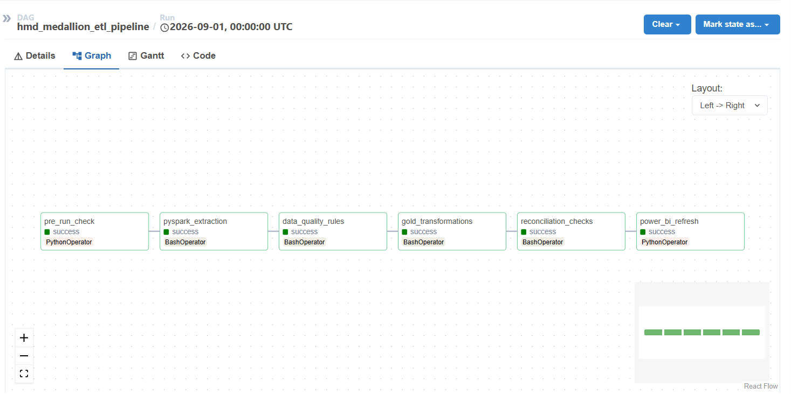
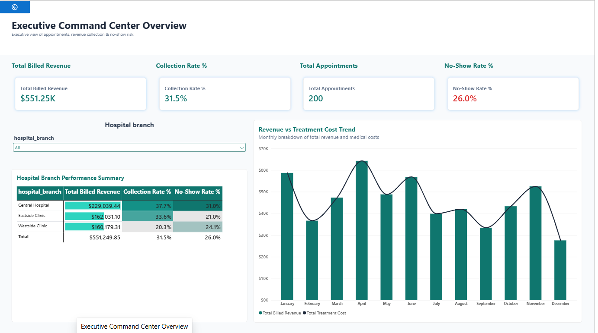
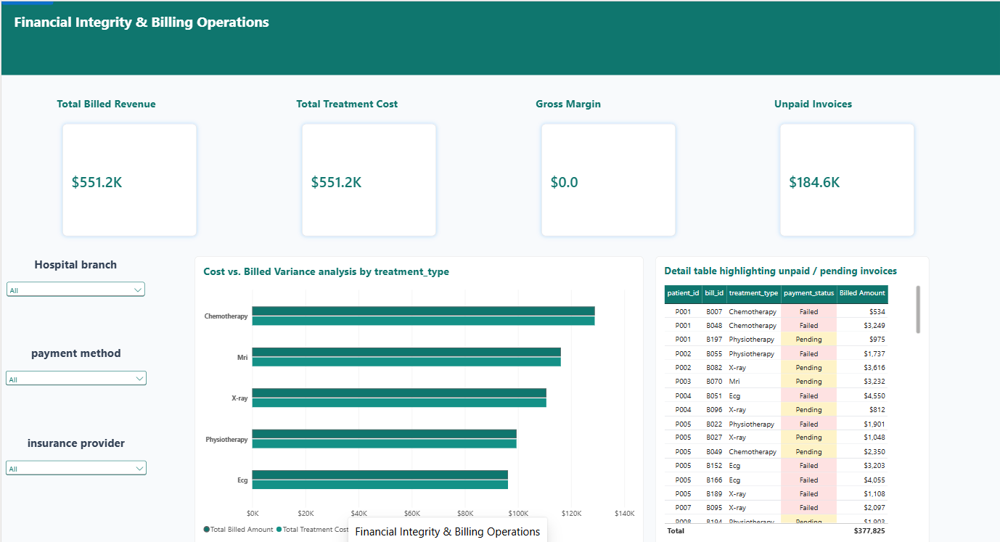
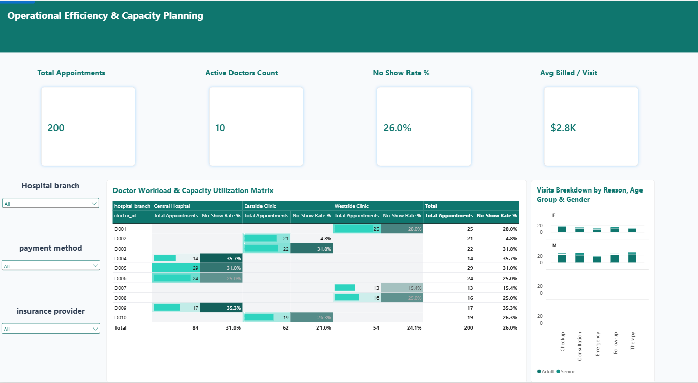

# Healthcare Analytics & Lakehouse Platform

An end-to-end, production-grade **Healthcare Operations & Financial Analytics Platform**, built on a Medallion (Bronze → Silver → Gold) Lakehouse architecture. The pipeline extracts operational data from a live PostgreSQL source, enforces automated data quality gates, models a dimensional star schema, and delivers a 3-page executive Power BI report — all orchestrated end-to-end by Apache Airflow.



---

## Table of Contents

- [Architecture](#architecture)
- [Tech Stack](#tech-stack)
- [Project Structure](#project-structure)
- [Data Quality & Governance](#data-quality--governance)
- [Gold Layer — Star Schema](#gold-layer--star-schema)
- [Orchestration](#orchestration)
- [Power BI Dashboard](#power-bi-dashboard)
- [Getting Started](#getting-started)
- [Reconciliation & Data Integrity](#reconciliation--data-integrity)
- [Recent Updates (October 2026)](#recent-updates-october-2026)
- [Known Assumptions & Limitations](#known-assumptions--limitations)

---

## Architecture

```
Neon PostgreSQL (source)
        │  JDBC extract
        ▼
   BRONZE  (MinIO, s3a://hmd-lakehouse/bronze/)
        │  raw, immutable, append-only, partitioned by ingestion date
        ▼
 DATA QUALITY GATEWAY  ──▶  QUARANTINE  (failed records + reason logs)
        │  cleaned, deduplicated, referentially validated
        ▼
   SILVER  (MinIO, s3a://hmd-lakehouse/silver/)
        │  star-schema transformation
        ▼
   GOLD    (MinIO  ·  Neon Postgres serving layer  ·  local Parquet export)
        │
        ▼
   Power BI  (3-page report — Python connector reads Gold from Neon)
```

Every stage is orchestrated by a single Airflow DAG (`hmd_medallion_etl_pipeline`) running on **CeleryExecutor** with a Redis broker, with real health checks, automated reconciliation, and a Power BI refresh trigger as the final step.

## Tech Stack

| Layer | Technology |
|---|---|
| Source Database | Neon PostgreSQL |
| Object Storage / Lakehouse | MinIO (S3-compatible) |
| Processing Engine | PySpark (S3A connector) |
| Storage Format | Parquet |
| Orchestration | Apache Airflow — CeleryExecutor + Redis broker, dedicated Postgres metadata DB |
| Data Quality & Governance | Custom PySpark DQ Gateway |
| BI & Reporting | Power BI (Python connector → Neon Postgres; Parquet fallback) |
| Containerization | Docker Compose |

## Project Structure

```
healthcare-analytics-lakehouse/
├── dags/
│   └── hmd_medallion_etl_pipeline.py     # Airflow DAG definition
├── scripts/
│   ├── 00_test_connections.py            # Ad-hoc connectivity smoke test
│   ├── 01_bronze_ingestion.py            # Neon -> MinIO Bronze (append-only)
│   ├── 02_silver_ingestion.py            # DQ Gateway: Bronze -> Silver + Quarantine
│   ├── 03_gold_transformation.py         # Silver -> Gold star schema
│   ├── 04_reconciliation_checks.py       # End-to-end row-count & financial reconciliation
│   └── diagnose_neon.py                  # Neon connectivity diagnostics
├── output/                               # Local Parquet export consumed by Power BI
├── reports/                              # Power BI Project (.pbip) — semantic model + report
├── Healthcare_Analytics_Lakehouse_Presentation.pptx   # Project deck (v2 — October 2026)
├── docker-compose.yaml
├── Dockerfile
├── requirements.txt
└── .env                                  # Not committed — see Getting Started
```

## Data Quality & Governance

Every table passes through a central **DQ Gateway** (`apply_dq_gateway`) before it's allowed into Silver. The gateway enforces:

| Rule | Description |
|---|---|
| **Uniqueness** | Primary keys must be non-null and unique. Duplicates from re-ingestion are resolved by keeping the latest `_ingested_at` per key. |
| **Date Sanity** | `appointment_date` cannot be set in the future. |
| **Positive Financials** | `billed_amount` and `treatment_cost` must be strictly greater than zero. |
| **Domain Enums** | `payment_status` must be one of `Paid`, `Pending`, `Failed`, `Refunded`. |
| **Referential Integrity** | Every foreign key (`patient_id`, `doctor_id`, `treatment_id`, ...) must resolve to a real parent row. |

Every rejected row is routed to `quarantine/failed_records/<table>/` with a full `_dq_failure_reason`, `_quarantined_at`, and `_source_table` audit trail — nothing is silently dropped.

## Gold Layer — Star Schema

| Dimension | Fact |
|---|---|
| `dim_patients` (age, age_group, insurance...) | `fact_appointments` (status, is_noshow, reason_for_visit) |
| `dim_doctors` (specialization, hospital_branch, experience_level) | `fact_billing_treatments` (billed_amount, treatment_cost, **revenue_variance**) |
| `dim_treatments` | |
| `dim_date` | |

`revenue_variance = billed_amount - treatment_cost` is calculated directly in the Gold layer and independently re-verified in the reconciliation script.

## Orchestration

The Airflow DAG runs six sequential tasks (executed by Celery workers via Redis), each gating the next on success:

1. **`pre_run_check`** — live connectivity check against Neon, MinIO health endpoint, and target bucket
2. **`pyspark_extraction`** — Bronze ingestion
3. **`data_quality_rules`** — Silver DQ Gateway
4. **`gold_transformations`** — star schema build
5. **`reconciliation_checks`** — end-to-end row-count & financial reconciliation (fails the run on any mismatch)
6. **`power_bi_refresh`** — triggers a Power BI Service dataset refresh via the REST API

A failure at any stage blocks every task downstream — a broken pipeline never silently reports success.

## Power BI Dashboard

Three interactive pages, built on the Gold star schema and redesigned in October 2026 — white branded header with a live *Data last refreshed* stamp, a dedicated **Filters** panel (Hospital Branch, Payment Method, Insurance Provider, Treatment Type), KPI cards with visible labels and `$K` data labels, plus Refresh / Clear Filters controls:

### Page 1 — Executive Command Center Overview


### Page 2 — Financial Integrity & Billing Operations


### Page 3 — Operational Efficiency & Capacity Planning


## Getting Started

**1. Configure environment**

Copy the example and fill in your own credentials — never commit real secrets:

```bash
cp .env.example .env
```

Required variables: `NEON_HOST/PORT/DB/USER/PASSWORD`, `MINIO_ENDPOINT/ACCESS_KEY/SECRET_KEY`, `POSTGRES_USER/PASSWORD/DB` (Airflow metadata), `AIRFLOW_FERNET_KEY` (generate with `python -c "from cryptography.fernet import Fernet; print(Fernet.generate_key().decode())"`), and optionally `POWERBI_TENANT_ID/CLIENT_ID/CLIENT_SECRET/DATASET_ID` for the automated refresh step plus `SMTP_*` for Airflow email alerts.

**2. Launch the stack**

```bash
docker compose up airflow-init   # one-time: migrates the metadata DB, creates the admin user
docker compose up -d
```

**3. Trigger the pipeline**

Open the Airflow UI at `http://localhost:8082` (default login `admin` / `admin`) and trigger `hmd_medallion_etl_pipeline`.

**4. Connect Power BI**

The semantic model's Python connector reads the Gold star schema directly from Neon Postgres (`public` schema) using the credentials in `.env` — no hard-coded local paths. The `./output/` Parquet files are still exported by the Gold layer as a fallback for ad-hoc analysis. See `reports/` for the ready-to-open Power BI Project (`Healthcare_Operational_Efficiency.pbip`).

## Reconciliation & Data Integrity

`04_reconciliation_checks.py` runs as the final gate before any BI refresh, and independently re-verifies (not just trusts) the entire pipeline:

- **Bronze → Silver**: raw Bronze row count/financial sum must exactly equal `Silver + Quarantine`
- **Silver → Gold**: row counts and financial sums must match exactly (zero tolerance — this join is lossless by construction)
- **Formula sanity**: `SUM(revenue_variance)` is independently recomputed as `SUM(billed_amount) - SUM(treatment_cost)` and compared against the stored value

Any mismatch fails the Airflow task immediately, rather than allowing a silently incomplete dataset to reach the dashboard.

## Recent Updates (October 2026)

- **Power BI report redesign** — white branded header on all three pages, a dedicated **Filters** panel, KPI cards with visible labels and `$K` data labels, and Refresh / Clear Filters controls.
- **Live "Data last refreshed" stamp** — a new `'Data Last Refreshed'` DAX measure (`FORMAT(NOW(), ...)`) replaces the static timestamp and updates automatically on every model refresh.
- **Gold serving layer in Neon** — `03_gold_transformation.py` now writes the star schema back to Neon Postgres (parallel `ThreadPoolExecutor` writes) in addition to MinIO and the local Parquet export; the Power BI semantic model reads `public.*` tables through the Python connector instead of hard-coded local file paths.
- **Airflow on Celery + Redis** — `docker-compose.yaml` moved from LocalExecutor to CeleryExecutor with a Redis broker, a dedicated Postgres metadata DB, SMTP alert variables, and `GOLD_LOCAL_EXPORT_DIR=/opt/airflow/output` volume-mounted back to the host.
- **New project deck** — the presentation was regenerated to match this state (replaces the pre-update deck). [Open / download the latest deck (direct link, bypasses the browser preview cache)](https://raw.githubusercontent.com/moabdoamer123-cmd/healthcare-analytics-lakehouse/5763f4ac97b5c3f6909b3956d9338aafea2d3dd6/Healthcare_Analytics_Lakehouse_Presentation.pptx).
- **Fresh dashboard screenshots** — all three page screenshots in this README (and in the deck) were re-captured from the redesigned report on October 10, 2026.

---

## Known Assumptions & Limitations

- **Gross Margin shows $0.00**: the source dataset's `billing.amount` and `treatments.cost` are identical for every transaction, so billed revenue exactly equals treatment cost. This is a property of the sample data, not a modeling error.
- **"Capacity Utilization"** is reported as actual doctor workload (appointments, completions, cancellations, no-shows) rather than a percentage against a fixed capacity, since the source data has no explicit daily-capacity target per doctor.
- **Power BI connectivity**: Power BI Desktop has no native connector for MinIO or generic S3-compatible storage. The Gold layer is therefore written three ways — to MinIO (satisfying the lakehouse architecture requirement), back to Neon Postgres (the serving layer Power BI reads through the Python connector), and as local Parquet files in `./output/` for ad-hoc analysis.